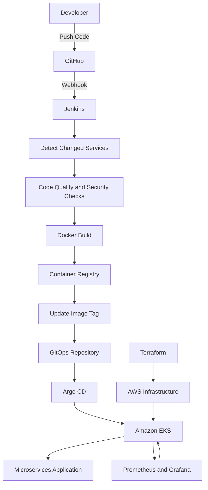
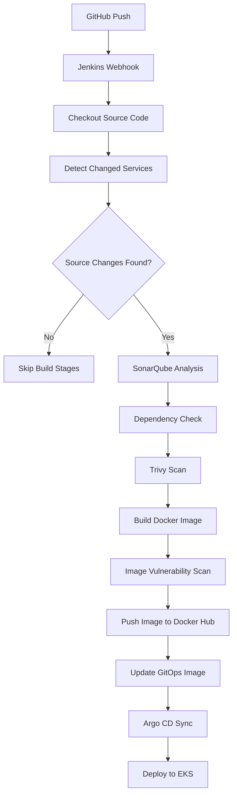

# AWS EKS-Based Microservices Deployment & GitOps Automation

An end-to-end DevOps project demonstrating automated CI/CD, Infrastructure as Code, container orchestration, and GitOps-based deployment of a cloud-native microservices application on Amazon EKS.

The project uses Jenkins for continuous integration, Docker for containerization, Terraform for infrastructure provisioning, Kubernetes and Helm for application deployment, and Argo CD for continuous delivery through GitOps.

---

## Project Overview

This project focuses on automating the software delivery lifecycle of a microservices-based e-commerce application.

The application consists of multiple independent services communicating with each other using gRPC. The DevOps implementation automates infrastructure provisioning, application builds, security and quality checks, container image publishing, and Kubernetes deployments.

**Primary objective:** Build an automated deployment workflow where application code changes trigger the CI pipeline, and successful image updates are deployed to Kubernetes through Argo CD.

## Architecture



### Infrastructure Architecture

Terraform provisions the AWS infrastructure required to run the Kubernetes environment.

The infrastructure includes:

- Amazon VPC and networking components.
- Public and private subnets.
- Internet Gateway and NAT Gateway.
- Amazon EKS cluster.
- Managed Kubernetes worker nodes.
- IAM roles and permissions.
- Security groups.
- AWS Load Balancer Controller integration.

Application traffic is routed through the AWS load-balancing infrastructure to Kubernetes workloads.

---

## Technology Stack

| Category | Technologies |
|---|---|
| Cloud | AWS |
| Infrastructure as Code | Terraform |
| Containerization | Docker |
| Container Orchestration | Kubernetes, Amazon EKS |
| CI/CD | Jenkins |
| Pipeline Reusability | Jenkins Shared Libraries |
| GitOps | Argo CD |
| Image Automation | Argo CD Image Updater |
| Package Management | Helm |
| Container Registry | Docker Hub |
| Code Quality | SonarQube |
| Security Scanning | Trivy, OWASP Dependency Check |
| Networking | AWS Load Balancer Controller, Gateway API |
| DNS Management | ExternalDNS |
| Monitoring | Prometheus, Grafana |
| Logging | Loki, Alloy |
| Application Communication | gRPC |
| Version Control | Git, GitHub |

---

## Key Implementations

### 1. Infrastructure Provisioning with Terraform

- Automated AWS infrastructure provisioning using Terraform.
- Created VPC networking with public and private subnets.
- Provisioned Amazon EKS and its supporting infrastructure.
- Configured IAM permissions and security groups.
- Integrated AWS Load Balancer Controller for external traffic routing.

### 2. Jenkins CI Pipeline

Implemented an automated Jenkins pipeline using a separately maintained Jenkins Shared Library.

Pipeline responsibilities include:

- GitHub webhook-based pipeline triggering.
- Source code checkout.
- Detection of changed microservices.
- Code quality analysis using SonarQube.
- Dependency vulnerability checks.
- Filesystem and container image scanning using Trivy.
- Docker image building and publishing.
- Automated image version management.

**Optimized build process:** Implemented changed-service detection so that subsequent pipeline executions build only the microservices whose source code has changed, rather than rebuilding every service unnecessarily.

### 3. Jenkins Shared Libraries

Designed a reusable Jenkins Shared Library to separate pipeline logic from application-specific Jenkinsfiles.

This approach provides:

- Reusable pipeline functions.
- Centralized CI logic.
- Easier maintenance.
- Consistent pipeline execution across microservices.
- Reduced duplication in Jenkinsfiles.

### 4. GitOps with Argo CD

Implemented GitOps-based continuous delivery using Argo CD.

Workflow:

1. Jenkins builds and pushes updated container images.
2. Image updates are reflected in the GitOps configuration.
3. Argo CD Image Updater automates image update handling.
4. Argo CD detects changes in the Git repository.
5. Argo CD synchronizes the desired application state with Amazon EKS.
6. Kubernetes deploys the updated application workloads.

This separates the CI build process from the CD deployment process.

### 5. Kubernetes and Helm

- Deployed the microservices application on Amazon EKS.
- Used Helm charts to manage Kubernetes application deployments.
- Organized Kubernetes configuration and deployment manifests.
- Configured application networking through Gateway API resources.
- Implemented workload scaling configurations.
- Used Kubernetes declarative configuration for application management.

### 6. Monitoring and Logging

Integrated observability components to monitor the Kubernetes environment and application workloads.

- **Prometheus:** Metrics collection and monitoring.
- **Grafana:** Visualization of monitoring metrics through dashboards.
- **Loki:** Centralized log aggregation.
- **Alloy:** Log collection and forwarding.

The observability stack helps inspect workload health, application behavior, and operational issues.

---

## CI/CD Workflow



## Repository Structure

```text
.
├── Jenkins/
│   └── Jenkins pipeline configuration
│
├── argocd/
│   └── Argo CD application configurations
│
├── gateway-api-manifests/
│   └── Gateway API resources
│
├── helm-chart/
│   └── Helm deployment charts
│
├── microservices-extra-kube-manifests/
│   └── Additional Kubernetes resources
│
├── observability/
│   └── Monitoring and logging configurations
│
├── protos/
│   └── gRPC protocol definitions
│
├── scaling/
│   └── Kubernetes scaling configurations
│
├── src/
│   └── Microservices application source code
│
├── terraform/
│   └── AWS infrastructure provisioning
│
├── build-images.sh
└── kustomization.yaml
```

---

## Engineering Highlights

- Implemented a reusable Jenkins Shared Library architecture.
- Automated microservice-specific build execution using source change detection.
- Integrated code quality and vulnerability scanning into CI.
- Separated CI and CD responsibilities using GitOps.
- Automated image update handling with Argo CD Image Updater.
- Used Terraform to manage cloud infrastructure as code.
- Managed Kubernetes application deployments using Helm.
- Integrated monitoring and centralized logging components.

## Skills Demonstrated

`DevOps` `CI/CD` `AWS` `Terraform` `Jenkins` `Docker` `Kubernetes` `Amazon EKS` `Argo CD` `GitOps` `Helm` `Prometheus` `Grafana` `Loki` `SonarQube` `Trivy` `Jenkins Shared Libraries`

## Application Source

This project uses the Online Boutique microservices demonstration application as its application foundation.

Original upstream repository:  
https://github.com/GoogleCloudPlatform/microservices-demo

## Author

**Abhinav Raj**

Full Stack Developer | DevOps Engineer (Fresher)

GitHub: https://github.com/avinavvv

---

*This repository is intended as a hands-on demonstration of infrastructure automation, CI/CD engineering, Kubernetes orchestration, GitOps, and observability practices.*
