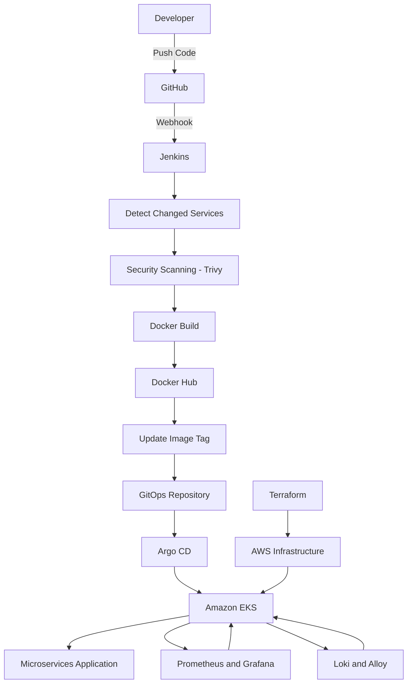
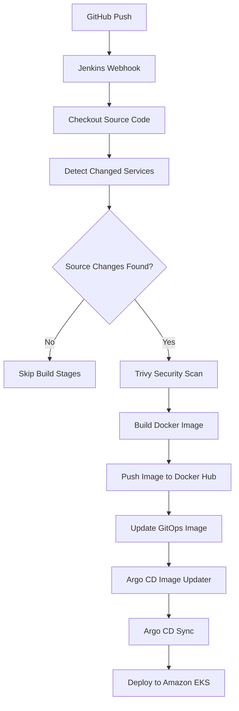

# AWS EKS-Based Microservices Deployment & GitOps Automation

An end-to-end DevOps project showcasing automated CI/CD, Infrastructure as Code, and GitOps-based deployment of a cloud-native microservices application on Amazon EKS.

The project leverages AWS infrastructure, including VPC, public and private subnets, Internet Gateway, NAT Gateway, and Amazon EKS to establish a secure and scalable Kubernetes environment. Terraform automates infrastructure provisioning, Jenkins handles CI pipelines, Docker manages containerization, and Argo CD enables GitOps-based continuous delivery using Kubernetes and Helm.

---

## Project Overview

This project focuses on automating the complete deployment lifecycle of a microservices-based e-commerce application.

It combines AWS cloud infrastructure, automated CI pipelines, container orchestration, GitOps-based deployments, and monitoring to establish an automated DevOps workflow.

**Primary Objective:** Automate application builds, security scanning, container image publishing, and Kubernetes deployments while managing cloud infrastructure through Terraform and application delivery through GitOps.

## Architecture



### AWS Infrastructure Architecture

Terraform provisions and manages the AWS infrastructure required to run the Kubernetes environment.

Key infrastructure components:

- **Amazon VPC:** Provides an isolated networking environment.
- **Public and Private Subnets:** Organize infrastructure and Kubernetes workloads across network tiers.
- **Internet Gateway:** Enables internet connectivity for public subnet resources.
- **NAT Gateway:** Provides outbound internet access to resources in private subnets.
- **Amazon EKS:** Managed Kubernetes control plane for container orchestration.
- **Managed Node Groups:** Run application workloads on Kubernetes worker nodes.
- **IAM Roles and Security Groups:** Manage access permissions and network security.
- **AWS Load Balancer Controller:** Integrates Kubernetes networking with AWS load balancing.

---

## Technology Stack

| Category | Technologies |
|---|---|
| Cloud | AWS |
| Infrastructure as Code | Terraform |
| Containerization | Docker |
| Container Orchestration | Kubernetes, Amazon EKS |
| CI/CD | Jenkins |
| Pipeline Reusability | Jenkins Shared Libraries |
| GitOps | Argo CD |
| Image Automation | Argo CD Image Updater |
| Package Management | Helm |
| Container Registry | Docker Hub |
| Security Scanning | Trivy |
| Networking | AWS Load Balancer Controller, Gateway API |
| Monitoring | Prometheus, Grafana |
| Logging | Loki, Alloy |
| Application Communication | gRPC |
| Version Control | Git, GitHub |

---

## Key Implementations

### 1. AWS Infrastructure Provisioning with Terraform

- Automated AWS infrastructure provisioning using Terraform.
- Created VPC networking with public and private subnets.
- Configured Internet Gateway and NAT Gateway.
- Provisioned Amazon EKS and managed node groups.
- Configured IAM permissions and security groups.
- Integrated AWS Load Balancer Controller for external traffic routing.

### 2. Jenkins CI Pipeline

Implemented an automated Jenkins CI pipeline using a separately maintained Jenkins Shared Library.

Pipeline responsibilities include:

- GitHub webhook-based pipeline triggering.
- Source code checkout.
- Detection of changed microservices.
- Docker image building.
- Container image vulnerability scanning using Trivy.
- Publishing Docker images to Docker Hub.
- Automated image version management.

**Optimized Build Process:** Implemented changed-service detection so that subsequent pipeline executions build only the microservices whose source code has changed, instead of rebuilding every service unnecessarily.

### 3. Jenkins Shared Libraries

Designed a reusable Jenkins Shared Library to separate pipeline logic from application-specific Jenkinsfiles.

Key benefits:

- Reusable pipeline functions.
- Centralized CI logic.
- Easier maintenance.
- Consistent pipeline execution.
- Reduced code duplication across Jenkins pipelines.

### 4. GitOps with Argo CD

Implemented GitOps-based continuous delivery using Argo CD.

Workflow:

1. Jenkins builds and pushes updated container images.
2. Updated image tags are reflected in the GitOps configuration.
3. Argo CD Image Updater automates image update handling.
4. Argo CD detects changes in the Git repository.
5. Argo CD synchronizes the desired application state with Amazon EKS.
6. Kubernetes deploys the updated application workloads.

This approach separates CI build responsibilities from CD deployment responsibilities.

### 5. Kubernetes and Helm

- Deployed the microservices application on Amazon EKS.
- Used Helm charts to manage Kubernetes application deployments.
- Organized Kubernetes configuration and deployment manifests.
- Configured application networking through Gateway API resources.
- Implemented workload scaling configurations.
- Used declarative Kubernetes configurations for application management.

### 6. Monitoring and Logging

Integrated observability components to monitor the Kubernetes environment and application workloads.

- **Prometheus:** Collects and stores monitoring metrics.
- **Grafana:** Visualizes metrics through monitoring dashboards.
- **Loki:** Provides centralized log aggregation.
- **Alloy:** Collects and forwards application and infrastructure logs.

This observability setup helps inspect workload health, application behavior, and operational issues.

---

## CI/CD Workflow



---

## Repository Structure

```text
.
├── Jenkins/
│   └── Jenkins pipeline configuration
│
├── argocd/
│   └── Argo CD application configurations
│
├── gateway-api-manifests/
│   └── Gateway API resources
│
├── helm-chart/
│   └── Helm deployment charts
│
├── microservices-extra-kube-manifests/
│   └── Additional Kubernetes resources
│
├── observability/
│   └── Monitoring and logging configurations
│
├── protos/
│   └── gRPC protocol definitions
│
├── scaling/
│   └── Kubernetes scaling configurations
│
├── src/
│   └── Microservices application source code
│
├── terraform/
│   └── AWS infrastructure provisioning
│
├── build-images.sh
└── kustomization.yaml
```

---

## Engineering Highlights

- Automated AWS infrastructure provisioning using Terraform.
- Implemented reusable Jenkins Shared Library architecture.
- Automated microservice-specific builds using source change detection.
- Integrated container vulnerability scanning using Trivy.
- Implemented GitOps-based continuous delivery with Argo CD.
- Automated image update handling using Argo CD Image Updater.
- Managed Kubernetes deployments using Helm.
- Integrated monitoring and centralized logging using Prometheus, Grafana, Loki, and Alloy.

## Skills Demonstrated

`AWS` `Terraform` `Jenkins` `Jenkins Shared Libraries` `Docker` `Kubernetes` `Amazon EKS` `Argo CD` `GitOps` `Helm` `Trivy` `Prometheus` `Grafana` `Loki` `Alloy` `CI/CD`

---

## Author

**Abhinav Raj**

DevOps Engineer

GitHub: https://github.com/avinavvv

---

*This project demonstrates practical implementation of AWS infrastructure automation, CI/CD engineering, Kubernetes orchestration, GitOps, and observability practices.*
